  

  <a href="mailto:a522zhan@uwaterloo.ca"><ins>a522zhan@uwaterloo.ca</ins></a>
  &nbsp;|&nbsp;
  <a href="https://linkedin.com/in/aiden-zhang000"><ins>LinkedIn</ins></a>

---

## About Me

I'm a computer engineering student who enjoys building things, from low-level systems to polished, user-facing applications. I've worked on projects across software engineering, machine learning, computer vision, web development, and robotics; I'm also interested in embedded systems and firmware but interested in learning anything really. 

I pick up new tools quickly and am happy to work on whatever problem needs solving.

---

## Design Teams

- **Waterloo Aerial Robotics Group (WARG)**: Autonomy Software Developer
- **WATonomous**: Software Developer, Perception

---

## Skills

### Languages

### Frameworks

### Libraries

### Developer Tools

---

  Available for <b>Summer 2027</b> co-op. Feel free to contact me at
  <a href="mailto:a522zhan@uwaterloo.ca"><ins>a522zhan@uwaterloo.ca</ins></a>
  

